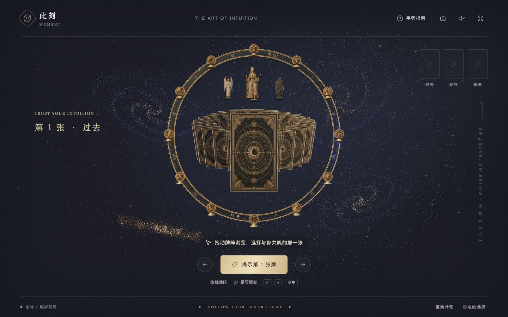
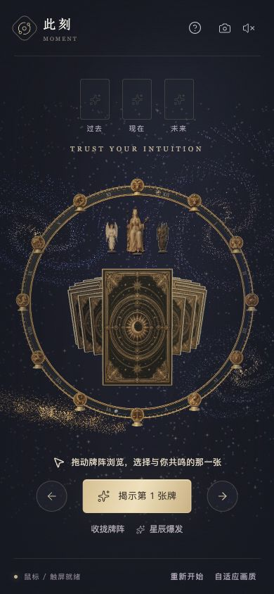

# 此刻 · MOMENT — 3D手势塔罗

用手掌轻移选牌，用食指稍停揭牌。在古铜天文钟与四片星系之间，抽出属于此刻的过去、现在和未来。

这是一个可在浏览器运行的交互作品，也适合 Web coding 初学者学习 Three.js 场景、手势输入和前端状态管理。不需要账号或 AI API Key；牌义、三牌总结与音效均在本地生成，用于娱乐与自我探索。



<details>
<summary>查看手机端效果</summary>



</details>

## 先玩起来

进入首页，22 张牌会左右往复，并依次经过前景。点击“手势”入口会立即停止首页自动运动，再加载模型、请求摄像头权限；也可以直接选择鼠标/触屏体验。进入选牌后，主动权交给你，短暂丢失手掌不会重新启动自动轮转，点击“重新开始”才恢复首页运动。

| 输入 | 操作 | 效果 |
| --- | --- | --- |
| 单手张掌 | 轻轻左右平移 | 连续浏览选牌；收拢状态下张掌可重新展开 |
| 食指朝上 | 稍停，等待指尖光圈填满 | 揭示当前高亮牌 |
| 握拳 | 保持到识别确认 | 收拢牌阵，保留已经抽取的牌 |
| 剪刀手 | 在选牌状态下做出手势 | 触发一次星辰爆发，随后回到牌阵 |
| 鼠标/触屏 | 横向拖动或点左右箭头 | 浏览牌阵 |
| 鼠标/触屏 | 点击卡牌或揭牌按钮 | 揭牌 |
| 键盘 | `←` / `→`，选牌时按空格 | 浏览 / 揭牌；收拢时 `Esc` 重新展开 |

连续抽出三张牌后，结果页会给出**白话总结、一个具体假设例子、今天可以做的一步和原创寄语**。点击“保存我的启示”可导出 PNG。页脚的“自动演示”是明确标识的演示流程，与首页往复动画分开。

## 画面与动效

- **正圆古铜珐琅天文钟**：同心刻度、罗马数字、倒角亮边与小型日月细节。中央中空，布局约束为卡牌、人物、钟环留出空隙，没有穿过牌阵的长针或辐条。
- **十二枚独立铜徽章**：白羊、公牛、天秤、双鱼等不同浮雕纹样，共用一张独立十二宫图集。每枚都有短铜底座，保持正面直立、固定在外圈。
- **三位人物**：中央命运女神随主动切牌连续顺时针绕竖轴转身，手停后随钟盘惯性逐渐收住；左侧天使、右侧恶魔固定朝内，高度约为女神的 64%。人物由已有正背面图像构成有厚度的闭合浅浮雕，侧面不会缩成一条线，但不是完整圆雕模型。
- **22 张独立彩色哥特牌面**：每张牌有自己的角色、场景、配色和牌义；统一的黑金牌背隐藏身份。
- **分层星空与触发动效**：四片有深浅与倾角的星系、克制的多面 3D 碎片；转牌时短暂出现金尘和金属运动光，揭牌时选中牌边缘发出一次集中光晕与碎星，随后收敛。揭牌与结果阶段装饰淡下，卡牌保持为视觉中心。
- **轻量与减少动态**：页脚可切换轻量画质，降低粒子与几何负担；系统开启“减少动态效果”时，持续运动与触发粒子受抑制，核心选牌与结果流程仍可使用。
- **本地音效**：Web Audio 合成，默认关闭，通过页面音量按钮开启。

## 本地启动

准备 Node.js **24.x** 和 pnpm **11.19.0**。已有 pnpm 可跳过安装步骤；从仓库获取代码后，在项目根目录运行：

```sh
npm install --global pnpm@11.19.0
pnpm install --frozen-lockfile
pnpm dev --host 127.0.0.1 --port 5187
```

仓库固定了 pnpm 版本并保留依赖锁文件；全新克隆不需要任何本机平台绑定文件。

打开终端显示的 HTTP 地址，例如 `http://127.0.0.1:5187/`。不要双击 HTML 文件启动，也不要用 `file://` 测试摄像头。

首次启动会复制锁定版本的 MediaPipe WASM，并下载、校验手势模型；需要网络，稍等即可。源码不包含这些生成文件，部署前会自动准备。详情见[资源与校验说明](docs/ASSETS.md)。

### 摄像头与隐私

摄像头需要 **HTTPS 或 localhost/127.0.0.1** 安全上下文及浏览器授权。手机访问电脑的普通局域网 HTTP 地址可能无法授权，请使用 HTTPS 部署。没有摄像头、拒绝授权或设备不支持 WebGL 时，可使用页面提供的鼠标/触屏入口或回退界面。

手势推理在浏览器内执行；模型和 WASM 由本站自托管，应用不上传摄像头帧。原始视频元素隐藏，界面只绘制 21 个手部关键点组成的骨架。首次开启手势需要加载模型，看到等待手掌提示后再操作；可关闭摄像头后继续鼠标体验。

## 验证与复用

```sh
pnpm exec tsc --noEmit --incremental false
pnpm exec oxlint src app
node --experimental-strip-types --test src/scene/*.test.ts src/gestures/*.test.ts src/data/*.test.ts
pnpm run build:vercel
```

源码锁定依赖，修改代码后优先运行相关测试，再检查实际画面与控制台。模型推理、页面渲染和交互状态分开，适合逐块阅读：

```text
app/                          页面入口、全局样式
src/TarotExperience.tsx        仪式状态、输入切换、结果与页面按钮
src/scene/                    Three.js 牌阵、天文钟、人物、星系与光效
  card-layout.ts              卡牌目标姿态
  frame-layout.ts             正圆布局与投影避让
  idle-motion.ts              首页往复与接管逻辑
  clock-motion.ts             主动输入驱动的单向钟盘运动
src/gestures/                 本地手势识别、消抖、连续位移和骨架预览
src/data/                     22 张牌、三牌总结与测试
src/lib/                      Web Audio、PNG 导出
public/art/                   实际运行图片与保留的历史素材
scripts/prepare-assets.mjs     WASM 准备与官方模型 SHA-256 校验
scripts/build-vercel.mjs       复用现有应用的 Vercel 静态构建
pnpm-lock.yaml                可复现依赖锁文件
```

想换牌义，从 `src/data/` 开始；想换配色或布局，从 `app/globals.css` 与 `src/scene/` 开始。不要直接放大卡片而跳过投影避让，人物转身和手机屏幕也会改变可用空间。

## 部署到 Vercel

运行 `pnpm run build:vercel` 生成 `dist-vercel/`，Vercel 选择 **Other** 并使用随仓库提供的配置。构建方式、公开访问与上线检查见[部署说明](docs/DEPLOYMENT.md)。实际仓库与公网地址将在创建和验证后补入；此文档不使用猜测的部署链接。

## 已验范围

本轮本地集成已检查桌面 1440×900、低高度桌面 1280×720、手机视口 390×844 和 360×740：首页运动、鼠标操作、收拢展开、揭牌、三牌结果、PNG 导出反馈、轻量及减少动态模式。已覆盖模型加载与仅骨架的等待手掌界面；生产逻辑和 Three.js 几何测试补充连续输入、人物转角与避让检查。

手机尺寸检查使用浏览器视口模拟，不等于所有真实手机已验收。**真人连续手势手感、不同光照/设备兼容性、量化 FPS 和导出图片逐像素质量尚未完成验证**。模型加载时可能出现 MediaPipe 初始化或性能警告；不要把模拟输入通过当作真人手势验收。

## 资源与使用边界

牌画和装饰图像由 AI 辅助制作，见[资源清单](docs/ASSETS.md)。本项目未指定开源许可证；公开演示不代表已授予源码或图片的再分发许可。MediaPipe、Google 模型及其他依赖保留各自的来源与许可，不能统一改写成本项目的许可。
